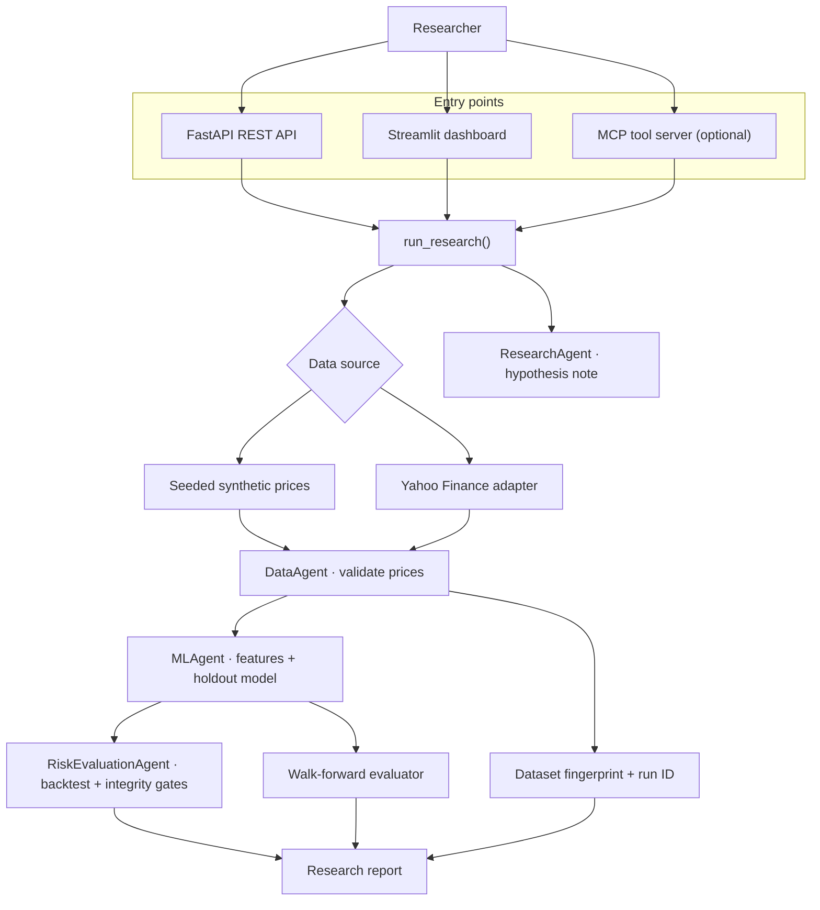
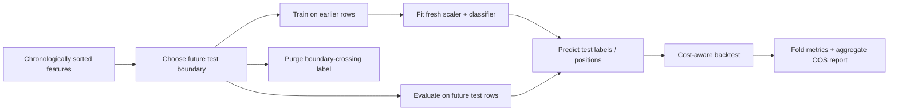

# QuantAgent

[](https://github.com/Bhaumik-99/QuantAgent-an-Agentic-Quant-Research-ML-Platform/actions/workflows/tests.yml)


**A deterministic quantitative research and machine-learning evaluation platform.** QuantAgent turns timestamped close-price data into features, chronological model evaluations, transaction-cost-aware backtests, integrity checks, and a reproducible research report.

> **Scope:** This is a research and engineering prototype. Its current “agents” are deterministic Python components—not autonomous LLM agents. Synthetic prices are useful for validating the pipeline, not for demonstrating investment alpha.

## What it does

- **Loads and validates prices** from a seeded synthetic generator or Yahoo Finance adjusted-close data.
- **Builds past-only features:** one-day return, five-day return, rolling 10-day volatility, and 10-day momentum.
- **Evaluates a baseline classifier:** StandardScaler + LogisticRegression, with a chronological holdout and an expanding-window walk-forward evaluation.
- **Checks temporal boundaries:** purges the observation whose next-period label would otherwise cross each training/test boundary.
- **Backtests long/flat positions:** applies signals to the matching next-period return, accounts for turnover-based transaction costs, and reports return, annualized Sharpe, drawdown, turnover, and buy-and-hold comparisons.
- **Reports reproducibility metadata:** dataset SHA-256 fingerprint, deterministic run identifier, agent trace, model metrics, walk-forward fold reports, and integrity checks.
- **Exposes the workflow through multiple interfaces:** FastAPI, Streamlit, and an optional Model Context Protocol (MCP) tool server.

## System architecture

This diagram reflects the current implementation. The orchestration is deterministic and sequential; the agents are small Python components with explicit responsibilities.



For component responsibilities, execution flow, and the evaluation boundary rules, see [the architecture guide](docs/architecture.md).

## Quickstart

Requires Python 3.11 or 3.12.

```bash
git clone https://github.com/Bhaumik-99/QuantAgent-an-Agentic-Quant-Research-ML-Platform.git
cd QuantAgent-an-Agentic-Quant-Research-ML-Platform

python -m venv .venv
```

Activate the environment, then install the project with development tools:

```bash
# macOS / Linux
source .venv/bin/activate

# Windows PowerShell
# .venv\Scripts\Activate.ps1

python -m pip install --upgrade pip
python -m pip install -e ".[dev]"
```

Run the checks:

```bash
ruff check quantagent tests scripts
pytest -q
python scripts/benchmark_workflow.py
```

### Run the API

```bash
uvicorn quantagent.api:app --reload
```

- Health: http://127.0.0.1:8000/health
- Interactive API documentation: http://127.0.0.1:8000/docs

Example research request:

```bash
curl -X POST "http://127.0.0.1:8000/research/run" \
  -H "Content-Type: application/json" \
  -d '{"symbol":"DEMO","source":"synthetic","periods":300,"seed":7,"transaction_cost_bps":5}'
```

The response includes the run ID, dataset fingerprint, model metrics, holdout backtest metrics, walk-forward fold and aggregate results, integrity checks, and an agent trace.

### Run the dashboard

In another terminal with the same environment activated:

```bash
streamlit run quantagent/dashboard.py
```

Choose synthetic data for a deterministic offline demo. The Yahoo Finance source requires network access and data availability from Yahoo Finance.

### Run the optional MCP server

Install the MCP extra:

```bash
python -m pip install -e ".[mcp]"
python -m quantagent.mcp.server
```

The server exposes get_market_data, train_model, run_backtest, evaluate_model, and compare_experiments. It uses standard MCP server transport; configure it in an MCP-compatible client as appropriate for your environment.

### Run with Docker

The included Dockerfile runs the API on port 8000:

```bash
docker build -t quantagent .
docker run --rm -p 8000:8000 quantagent
```

Open http://127.0.0.1:8000/docs.

## Research and evaluation design

### Features and target

| Field | Definition |
|---|---|
| return_1 | One-period percentage change in close |
| return_5 | Five-period percentage change in close |
| volatility_10 | Rolling standard deviation of one-period returns over 10 observations |
| momentum_10 | Ten-period percentage change in close |
| next_return | close(t+1) / close(t) - 1 |
| target | 1 if next_return > 0; otherwise 0 |

Features at time t use current and prior closes. The label is the next-period direction. The classifier uses a fixed 0.5 probability threshold and maps predictions to long (1) or flat (0) positions.

### Temporal evaluation

The workflow has two evaluation views:

1. **Chronological holdout:** by default, the first 70% is the training boundary and the later observations form the holdout. The observation immediately before the boundary is purged because its next-period return depends on the first holdout close.
2. **Expanding-window walk-forward:** the default workflow uses a 50% initial training window and three future test folds. Each fold fits a new scaler and classifier on prior data; the boundary label is purged and test windows do not overlap.



### Backtest assumptions and metrics

- Position is either long (1) or flat (0); short selling, leverage, slippage modeling, and order-book execution are not implemented.
- The signal formed at close t applies to that row's next_return; the backtester intentionally does not shift it a second time.
- Trading costs are charged on position changes, including the initial entry. The default is 5 basis points per unit of turnover.
- Returns are compounded to calculate total return; Sharpe is annualized using 252 observations. Maximum drawdown, average turnover, cost assumptions, and buy-and-hold return/Sharpe/drawdown are reported.
- Results depend on the input data, features, time period, cost assumptions, and model. A passing test or reproducibility benchmark does **not** show that the strategy is profitable.

### Reproducibility and testing

The report contains a SHA-256 fingerprint of the normalized price frame and a deterministic run ID derived from the symbol, data source, seed, period argument, transaction-cost assumption, and fingerprint. The run timestamp is intentionally dynamic.

GitHub Actions runs Ruff, pytest, and the workflow contract/reproducibility benchmark on Python 3.11 and 3.12. The benchmark checks workflow success, report integrity, and repeated run-ID consistency; it is **not** an LLM-agent benchmark or a trading-performance benchmark.

## Repository layout

```text
quantagent/
  agents/              # Research note, data validation, ML, and risk/evaluation components
  mcp/                 # Optional MCP tool server
  api.py               # FastAPI endpoints
  dashboard.py         # Streamlit dashboard
  data.py              # Synthetic and Yahoo Finance data adapters
  features.py          # Feature and next-period target construction
  models.py            # Chronological holdout baseline
  validation.py        # Expanding-window walk-forward evaluation
  backtest.py          # Long/flat returns, costs, metrics, benchmark
  workflow.py          # End-to-end orchestration and report assembly
tests/                  # API, data, pipeline, and backtest/validation tests
scripts/                # Workflow contract/reproducibility benchmark
docs/                   # Architecture diagrams and detailed design notes
```

## Optional integrations

- .[tracking]: MLflow experimentation (optional dependency; not required by the default workflow).
- .[boosting]: XGBoost (optional dependency; not currently part of the default baseline path).
- .[mcp]: MCP server tools.

## Current limitations

- The baseline is a single logistic-regression classifier with four close-derived features; it is a reference pipeline, not a demonstrated source of alpha.
- The Yahoo Finance adapter currently requests a fixed five-year period. The periods parameter controls the synthetic generator and does not resize Yahoo Finance history.
- The run ID fingerprints inputs and current run parameters, but it is not a source-control commit identifier or a complete model-artifact registry.
- Agents are sequential Python functions, not LLM planners with autonomous tool selection, reflection, or research-loop control.
- No live-trading, brokerage, portfolio-construction, market-impact, or real order-execution integration is provided.

Contributions that improve correctness, stronger baselines, independent reproducibility, realistic costs, documentation, or test coverage are welcome. Keep evaluation leakage-safe and describe measured results without implying that historical performance predicts future returns.
