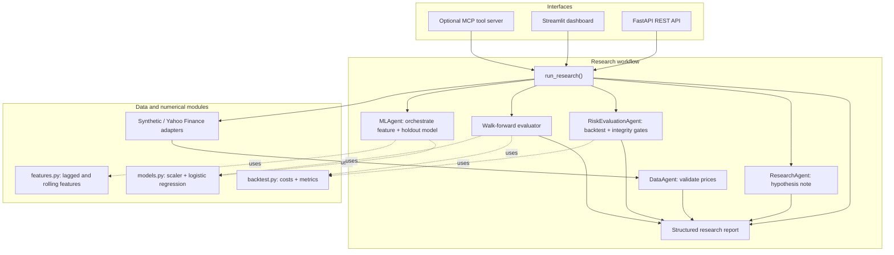
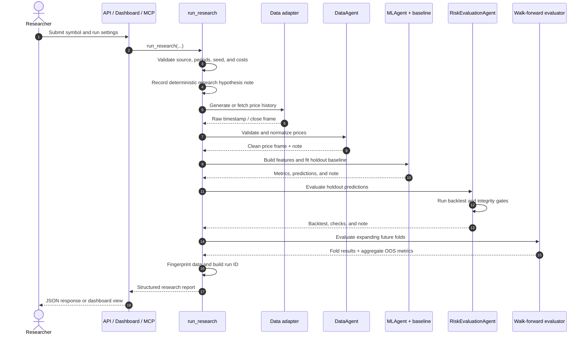
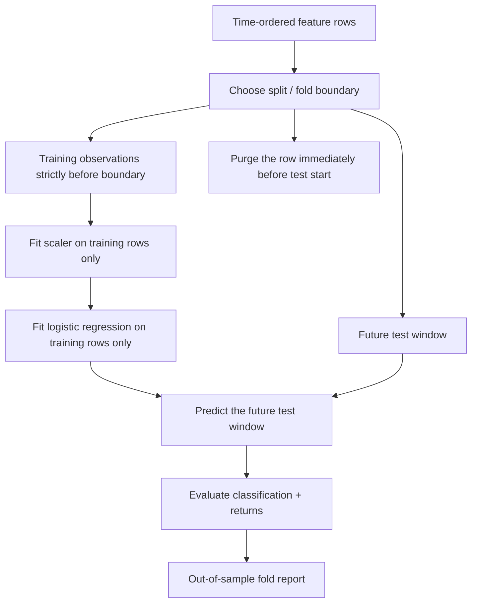
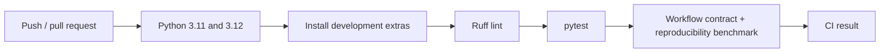

# QuantAgent architecture

This guide describes the implementation as it exists today. QuantAgent is a deterministic Python research workflow with API, dashboard, and optional MCP interfaces. The “agents” are role-named Python components, not autonomous LLM workers.

## 1. Component boundaries

### Module responsibilities

| Module | Responsibility |
|---|---|
| quantagent/data.py | Generate deterministic synthetic prices, fetch Yahoo Finance adjusted-close prices, normalize timestamps, and validate price inputs. |
| quantagent/features.py | Create lagged/rolling features plus the next-period return and binary direction target. |
| quantagent/models.py | Fit a scaled logistic-regression baseline on an earlier chronological segment and produce holdout predictions. |
| quantagent/validation.py | Fit a fresh scaler/model for each expanding-window fold and aggregate non-overlapping out-of-sample predictions. |
| quantagent/backtest.py | Evaluate long/flat positions with turnover-based costs, compounding, drawdown, annualized Sharpe, and buy-and-hold comparisons. |
| quantagent/agents/ | Keep orchestration responsibilities explicit and record an AgentNote trace. |
| quantagent/workflow.py | Validate run arguments, orchestrate components, fingerprint normalized prices, and assemble the final report. |
| quantagent/api.py | Validate request payloads and expose health, market-data, and research endpoints. |
| quantagent/dashboard.py | Provide a small Streamlit UI over run_research(). |
| quantagent/mcp/server.py | Optionally expose market data, model, backtest, evaluation, and experiment-comparison tools. |

## 2. Runtime sequence

The current workflow is synchronous. It does not use a task queue or let an LLM dynamically plan tools.

## 3. Data and label construction

The input frame is normalized to timestamp and close columns. Timestamps are converted to timezone-naive UTC, sorted, and required to be unique; prices must be numeric, finite after coercion, and positive.

The feature builder computes:

- return_1: close(t) / close(t-1) - 1
- return_5: close(t) / close(t-5) - 1
- volatility_10: rolling standard deviation of the one-period return series
- momentum_10: close(t) / close(t-10) - 1
- next_return: close(t+1) / close(t) - 1
- target: 1 when next_return > 0, else 0

The final row has no future close and is dropped. Initial rows without enough lookback history are also dropped.

## 4. Temporal evaluation and leakage controls

Why purge a row? The label on row t includes the close at t+1. If that training row sits immediately before the test segment, its label consumes a price observation from the test segment. Purging removes that boundary-crossing label from model fitting.

Current defaults:

| Evaluation | Setting | Boundary handling |
|---|---|---|
| Chronological holdout | 70% train boundary | Purges the row just before the holdout; later observations form the test set. |
| Walk-forward | 50% initial training fraction, 3 folds in run_research() | Expanding training windows; fresh scaler and model per fold; one boundary row purged per fold; test windows do not overlap. |

No hyperparameter search is run. The walk-forward result is a historical simulation of one fixed baseline and its stated assumptions—not a guarantee of future results. Treat repeated feature/model experimentation as model selection, and reserve a final untouched period for any serious research claim.

## 5. Backtest semantics

For a prediction row at t, position is either long (1) or flat (0) and is multiplied by the corresponding next_return. The signal is not shifted a second time.

Turnover is the absolute change in position, with the first position treated as an entry from cash. A basis-point cost is charged per unit of turnover. Reported metrics include compounded total return, annualized Sharpe (252 observations per year), maximum drawdown, average turnover, cost assumption, and buy-and-hold equivalents.

This simplified model does not simulate fills, spread, slippage, borrow cost, market impact, partial execution, leverage, short positions, portfolio weights, corporate-action handling beyond the adjusted Yahoo Finance series, or intraday timing. These omissions constrain how results should be interpreted.

## 6. Report identity and reproducibility

The report includes:

- dataset_fingerprint_sha256: SHA-256 of the normalized price frame serialized to CSV.
- run_id: a truncated SHA-256 identifier derived from symbol, source, seed, requested period count, transaction costs, and the dataset fingerprint.
- created_at: the current UTC timestamp; this is intentionally not deterministic.
- model, backtest, walk_forward, integrity_checks, agent_trace, and a research-only disclaimer.

The run identifier makes repeated calls with the same synthetic settings and identical data easy to compare. It is not a source-control commit ID, a complete environment lock, or a model-artifact registry. Yahoo Finance output may change as data is revised.

## 7. Interfaces

| Interface | Run command | Endpoint / behavior |
|---|---|---|
| FastAPI | uvicorn quantagent.api:app --reload | GET /health, GET /market-data/{symbol}, POST /research/run; OpenAPI docs at /docs. |
| Streamlit | streamlit run quantagent/dashboard.py | Interactive controls for source, symbol, sample size/seed, and transaction costs. |
| MCP | Install the .[mcp] extra, then python -m quantagent.mcp.server | Exposes get_market_data, train_model, run_backtest, evaluate_model, compare_experiments. |
| Docker | docker build -t quantagent . then docker run --rm -p 8000:8000 quantagent | Container starts the FastAPI application on port 8000. |

The default installation does not install MCP, MLflow, or XGBoost. They are opt-in extras.

## 8. Continuous integration

CI verifies lint, tests, and repeated workflow contracts. The benchmark is not a measure of predictive quality, financial performance, latency under production load, or autonomous-agent reasoning.

## 9. Trust boundaries and limitations

- Yahoo Finance is an external data source and requires network access; its results can vary over time.
- API errors are surfaced as client errors for invalid inputs; unexpected internal failures are not intended to expose stack traces to API callers.
- MCP tools execute research functions using their supplied arguments. Use only trusted MCP clients and avoid exposing the service to untrusted networks without additional authentication and deployment controls.
- No authentication, authorization, rate limiting, persistent experiment database, or live-order API is implemented in the prototype.
- There is no autonomous LLM planning loop. The sequential responsibilities and trace are deterministic Python behavior.

These boundaries are part of the current design, not features the project claims to have.
